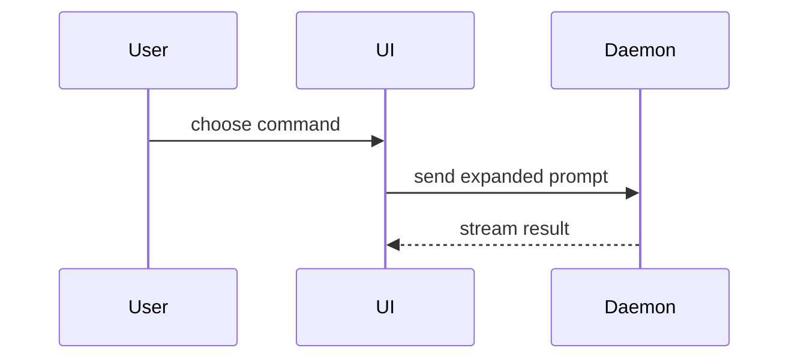

用这个模板写 PR body：

```markdown
## Summary

<diagram, diff-sketch, or tree>

## Evidence

- **Before:** <screenshot/output/failing test run>
  **After:** <screenshot/output/passing test run>

## Merge Danger

**Door:** <one-way or two-way>

<optional: description>

**Blast Radius:** <one-word description>

<optional: potential ramifications of merge>
```

## Sections

跳过所有开场白，prose 保持简短。使用项目 domain glossary（`CONTEXT.md` / `GLOSSARY.md`，如有）中的用户领域语言。

### Summary

选能讲清关键点的最小视图。

- 逻辑或算法用 pseudocode：

```text
on(save)
  if content is unchanged
    return cached result
  write new content
  return fresh result
```

- 运行时控制流用 call tree：

```text
submitForm
  createSession
    persistPrompt
    launchAgent
  navigateToSession
```

- UI 结构用 component tree，包括关键的 state 和 module 边界：

```text
<SessionPage> (apps/example/src/routes/session.tsx)
  useSessionEvents()
  <SessionToolbar>
    <RunSkillButton> (packages/ui)
```

- 文件职责或大范围重构用浅层 file tree：

```text
src/
├── commands/       # parses user actions
├── sessions/       # owns session state
└── transport/      # sends API requests
```

- 组件交互、控制流或数据流用 Mermaid：



- 当重点是“改了什么”且周围形状已存在时，用 `diff`。diff 的形状要匹配主题。

组件改动：

```diff
 <SessionPage>
   useSessionEvents()
   <SessionToolbar>
+    <RunSkillButton />
   <SessionTimeline>
+    <SkillResultCard />
```

文件布局改动：

```diff
 src/
 ├── commands/
+│   └── show-me.ts       # expands the slash command
 ├── sessions/
-└── transport.ts
+└── transport/
+    ├── client.ts
+    └── stream.ts
```

Call tree / call stack 改动：

```diff
 submitForm
   createSession
     persistPrompt
+    expandSkillMention
     launchAgent
-  navigateToSession
+  navigateToSession
+    subscribeToEvents
```

State 或控制流改动：

```diff
 on(save)
-  write content
+  if content is unchanged
+    return cached result
+  write new content
+  invalidate cache
```

- 当大部分是新代码、省略上下文会掩盖归属或顺序、或用户需要可复制的目标形状时，展示完整代码块：

```ts
function expandSkill(command: string): string {
  const skillName = command.slice(1);
  return `use the ${skillName} skill`;
}
```

#### Guidance

每个图示紧挨它所支撑的短文字。只保留回答当前问题、或解决当前讨论点所需的 calls、files、props、states 和 boundaries。

可以用一种，也可以用几种，基本不会全用。自己判断，不要让读者过载。

### Evidence

证明改动有效的具体证据，展示 before 和 after。

截图是 S 级：环境支持且改动是视觉性的时候使用。

基于执行的证据是 A 级：测试结果、console 输出。用 pseudocode 展示那条“之前失败、现在通过”的具体测试。

### Merge Danger

说明这是单向门还是双向门。双向门可以走回头路，单向门不行。回滚成本低的 PR 风险更低。涉及破坏性操作或难以逆转决策的改动是单向门。

Blast radius 是这个 PR 引入改动的潜在影响范围。考虑所有可能：layout shift、对使用方的破坏、移动端适配等。
