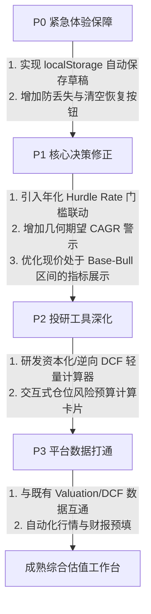

# 综合估值股票分析方案独立评审报告

**评审人**：Antigravity (Dispatched Worker)
**评审日期**：2026-10-22
**评审对象**：
- 页面：`src/pages/ComprehensiveValuation.tsx`
- 模型与测试：`src/features/comprehensive-valuation/model.ts`、`src/features/comprehensive-valuation/model.test.ts`
- 方法论与设计文档：`docs/investment-valuation-framework.md`、`docs/comprehensive-valuation-page.md`、`.agents/skills/stock-analysis/references/public-markets/multidimensional-valuation.md`

---

## 1. 独立执行摘要与核心判断

本评审基于对源码、数学公式、测试用例及设计文档的全面穿透式审查，并结合真实投资研究工作流，给出以下独立判断：

1. **方法论定位高度合理，决策纪律成熟**：
   “四维问题”（买什么、什么价格、什么时候、买多少）在顶层架构上逻辑严谨；对机械规则（如一刀切的 15% ROIC、基准情景绝对禁止估值扩张、机械套用二元凯利公式）的驳回具有扎实的金融学常识支撑；强调“证据驱动、区分事实与假设、不把主观概率称为客观胜率”体现了成熟投资者的风控自律。

2. **方法论正确性与实际工具完整度存在断层**：
   **方法论的严密不能掩盖前端工程工具的极度简陋**。当前交付的独立页面本质上是一个“纯手工输入 3 个目标价的二元价差速算表 + 4 个无持久化长文本输入框 + 8 个静态自查项”。方法论中承诺的核心支柱——如“研发资本化调整桥、逆向 DCF 现价隐含假设反解、SOTP 分部股权桥、仓位风险预算量化约束”——在前端工具中**完全没有任何交互计算与数据结构承载**，仅作为静态只读文本展示。这导致真实用户必须在外部自行完成全部高难度建模，页面沦为排版展示板，并可能产生“填表即严谨”的认知麻痹。

3. **核心建议总括**：
   **保留**四维决策纪律、三情景手工推演与 Markdown 导出；**修改**状态管理（紧急引入草稿本地持久化）、价差比边界处理（增加对非对称上行收益的考量与年化资金成本约束）、期望年化展示（揭示几何平均复合收益）；**拒绝**将当前纯手工展示卡定义为功能完备的“综合估值系统”，明确其“轻量级情景速算草稿卡”的工具边界。

---

## 2. 方法论正确性与实际工具完整度之别

在评估该方案时，必须严格切分“方法论（Methodology）”与“工具实现（Tooling Implementation）”，避免混为一谈：

| 维度 | 方法论规范（Framework & Skills） | 实际交付工具（ComprehensiveValuation.tsx / model.ts） | 真实工作流影响与落差 |
| :--- | :--- | :--- | :--- |
| **买什么（质量）** | 明确调整后 ROIC/WACC、增量回报、再投资率与每股稀释分析。 | 仅展示 3 行指导原则文本，提供 1 个纯文本输入框 `notes[0]`。 | 用户无任何历史数据参考、无行业基准对比，完全依赖用户在外部完成复杂财报分析后手动复制文本。 |
| **什么价格（估值）** | 强调研发资本化桥、逆向 DCF 求解隐含增长、SOTP 分部总和。 | 仅有 1 张 6 种方法的静态表格，随后直接要求输入 3 个期末情景价。 | **核心断层**：工具未提供任何“从经营假设到价格”的转换桥梁，用户输入 85/125/180 依然是无锚主观猜测。 |
| **什么时候（预期差）** | 强调一致预期快照、差异传导链、催化剂与到期验证日历；给出 `EPS × PE` 价格分解式。 | 仅提供 1 张静态算术卡片和纯文本框；公式无交互、无参数输入。 | 无法对动态市盈率/盈利增速做敏感性矩阵推演，无法处理非正 EPS 资产，催化剂无日历化记录。 |
| **买多少（仓位）** | 给出严格的 `min(上限, 损失预算/压力损失率, 流动性上限)` 多重风控约束。 | 仅展示一段纯文本公式 `<p className="cv-formula">`，无任何交互计算器。 | 投资者必须心算或手算仓位，工具未能有效防御“重仓冲动”。 |
| **数据与工作流** | 形成可复查、可复用的结构化投研交付物。 | 纯 React 组件内存 `useState`，无持久化存储，仅能单向导出 Markdown。 | 用户数小时深度研究输入极易因误触跳转、误刷新而彻底丢失，工作流极度脆弱。 |

---

## 3. 核心问题清单（按严重程度排序）

### 问题 1 (Critical / P0): 状态无持久化导致长篇深度投研证据面临毁灭性丢失风险
- **文件与行号**：`src/pages/ComprehensiveValuation.tsx#L88-L93`、`#L127`
- **机制分析**：
  页面中的所有核心业务状态（`company`, `currency`, `inputs`, `notes`, `checked`）完全保存在根组件的 React 本地 `useState` 中。用户未在浏览器持久化层（`localStorage` / `IndexedDB`）保存任何草稿状态。
- **工作流风险**：
  四维问题要求用户输入详尽的经营证据、反证、阈值与财报口径，往往需要长达数小时的思考与输入。然而：
  1. 页面在首屏 Header（`#L127`）提供了直达 `<Link to="/valuation">` 和 `<Link to="/dcf">` 的路由链接；
  2. 用户在填写过程中，若点击这些链接跳转去查看估值工作台或 DCF 计算器，或者浏览器意外刷新、崩溃、标签页被休眠释放，**当前页面的全部输入和研究卡草稿将彻底清空、无法恢复**。
- **改进建议**：
  引入 `useLocalStorage` 钩子或在 `useEffect` 中自动将表单序列化到 `localStorage`（如 key: `comprehensive_valuation_draft`），并增加“清空草稿”与“恢复上次草稿”按钮。

---

### 问题 2 (Severe / P1): 价差比指标对区间外（特别是成长股现价 >= 基准价）直接致盲，且单一依赖 2:1 易引发脱离期限的决策误判
- **文件与行号**：`src/features/comprehensive-valuation/model.ts#L48-L50`、`src/pages/ComprehensiveValuation.tsx#L71-L76`
- **代码实现**：
  ```ts
  const validRatio = wealth[0] < current && current < wealth[1]
  const ratio = validRatio ? (wealth[1] - current) / (current - wealth[0]) : null
  const threshold = wealth[0] / 3 * 2 + wealth[1] / 3
  ```
- **数学反例与实证推演**：
  - **反例 A（非对称成长资产功能瘫痪）**：
    假设一家处于转折期的优质科技公司，现价 $P = 102$。研究者评估：悲观情景（新业务完全失败）$Bear = 95$（损失约 6.8%）；基准情景（平稳维持）$Base = 100$；乐观情景（新业务爆发，类似期权兑现）$Bull = 300$（收益约 194%）。
    在此情景下，该资产具备极佳的向上赔率（向下风险极小，向上空间巨大）。然而，由于当前价格 $P > Base$（102 > 100），代码中的 `validRatio` 立即为 `false`，界面直接显示 **“价差比：不适用”、“2:1 对应研究价：不适用”**。工具对基准以上的非对称爆发型期权完全致盲，丧失了对成长股与特种投资的筛选价值。
  - **反例 B（脱离兑现期限的 2:1 价值陷阱）**：
    假设标的现价 $P = 100$，$Bear = 85$，$Base = 130$。价差比精确满足 $(130-100)/(100-85) = 30/15 = 2.0:1$。
    - 若兑现期限为 $T = 2$ 年，基准年化收益为 $\sqrt{1.3} - 1 = 14.02\%$，足以覆盖权益资本成本；
    - 但若该逻辑属于长周期慢周转重资产，兑现期为 $T = 10$ 年，基准年化收益仅为 $1.3^{1/10} - 1 = 2.66\%$，甚至远低于无风险国债利率！
    工具在 UI 上对 2:1 显示绿色积极评价（“达到约 2:1 的初筛偏好”），但缺乏“基准年化是否跑赢要求回报率（Hurdle Rate）”的门槛校验，容易诱导投资者买入赔率看似达标但年化极其平庸的“死钱（Dead Money）”。
- **改进建议**：
  1. 明确价差比适用的情景边界，并在 UI 上显著增加 **“基准年化回报 vs 要求回报率（如 8%-10%）”** 联动约束；
  2. 当 $Current \ge Base$ 但 $Current < Bull$ 时，提供次级指标“乐观上行/悲观下行比：$(Bull - P)/(P - Bear)$”，避免功能直接断流。

---

### 问题 3 (Severe / P1): 算术期望年化指标掩盖“几何破产/均值陷阱”（Flaw of Averages）
- **文件与行号**：`src/features/comprehensive-valuation/model.ts#L61-L63`、`src/pages/ComprehensiveValuation.tsx#L74-L78`
- **代码实现**：
  ```ts
  expected = scenarios.reduce((sum, row, i) => sum + probabilities[i] / 100 * row.returnRate, 0)
  expectedAnnualEquivalent = Math.pow(1 + expected, 1 / years) - 1
  ```
- **数学反例与实证推演**：
  - 假设兑现期限 $T = 2$ 年。投资者构建了如下高波动假设：
    - 悲观情景（概率 50%）：大幅受损，期末财富损失 80%（$R_1 = -80\%$）；
    - 乐观情景（概率 50%）：业绩爆发，期末财富翻倍（$R_2 = +100\%$）；
    - 基准情景（概率 0%）。
  - **当前工具的计算结果**：
    - 持有期算术期望收益率：$E[R] = 0.5 \times (-0.8) + 0.5 \times (+1.0) = +10\%$；
    - 期望终值年化等价：$(1 + 0.10)^{1/2} - 1 = \mathbf{+4.88\%}$。
    UI 大字提示用户：**“概率加权持有期收益 +10.00%”**，看似这是一笔有利可图、年化接近 5% 的投资。
  - **现实财富路径的残酷真相（几何平均复合增长率 CAGR）**：
    在多期投资或组合层面，资产的期望长期复合增长因子是几何平均值：
    $$G = \sqrt{(1 - 0.8) \times (1 + 1.0)} - 1 = \sqrt{0.2 \times 2.0} - 1 = \sqrt{0.4} - 1 \approx 0.6325 - 1 = \mathbf{-36.75\%}$$
    其复合年化实际收益率是：
    $$CAGR = (0.4)^{1/4} - 1 \approx 0.7953 - 1 = \mathbf{-20.47\%}$$
  - **本质危害**：
    该算术平均公式在肥尾、高回撤资产中存在严重的“平均值陷阱”。即使页面在折叠详情中用小字声明“不等于期望 CAGR”，但主屏依然以醒目的粗体展示正向收益率（$+10.00\%$），极易给决策者造成资本安全、期望为正的数学幻觉。
- **改进建议**：
  在输出算术期望收益的同时，并行计算并显式展示 **对数几何期望收益率 $\sum p_i \ln(1 + R_i)$** 或以醒目标签警示“几何期望亏损风险”，防止投资者被算术正期望误导。

---

### 问题 4 (Major / P2): 核心方法论（逆向 DCF、研发调整、仓位控制）未工具化，沦为“输入垃圾、输出垃圾（GIGO）”
- **文件与行号**：`src/pages/ComprehensiveValuation.tsx#L16-L23, L148`；`docs/investment-valuation-framework.md#L13-L16`
- **机制分析**：
  框架文档极其精辟地指出：“一个价格对应多组假设，逆向 DCF 需固定其他变量反解关键指标”、“研发重分类需要同步桥接投入资本与现金税”、“仓位受限于损失预算/压力损失率”。
  但在实际页面中，这全部退化成了纯静态文本介绍。用户在情景表格中填入的未来价格（85/125/180），完全脱离了任何财务驱动链条。没有任何工具帮助用户将“收入增长率、营业利润率、折现率、资本开支”转化为该价格。
- **工作流风险**：
  用户在缺乏建模向导的情况下，极易凭盘面感觉或股价走势图臆测三个情景价，随后页面以此为基础计算出高精度的价差比（如 1.67:1），制造了**高度伪精确的虚假科学感**。
- **改进建议**：
  1. 增加轻量级逆向求解小工具：根据当前价格反解所需 EPS 增速或自由现金流增速；
  2. 实现交互式仓位计算卡片：允许用户输入“账户总资产、单笔最大容忍亏损金额、悲观极端损失率”，自动输出建议仓位上限。

---

### 问题 5 (Moderate / P3): 分红累加未折现与税收缺失，且强制全单调校验阻断特殊清算情景
- **文件与行号**：`src/features/comprehensive-valuation/model.ts#L35, L37-L39`
- **代码实现**：
  ```ts
  const wealth = rows.map(row => row.price + row.dividend)
  ...
  if (wealth[0] > wealth[1] || wealth[1] > wealth[2]) {
    return { error: '含分红的期末价值须满足：悲观 ≤ 基准 ≤ 乐观，请检查情景定义。' } as const
  }
  ```
- **分析与反例**：
  1. **分红的时间价值与摩擦**：将未来 5 年或 10 年累加的每股分红与期末股价直接线性相加（`price + dividend`），在严格的财务假设下等价于“期间现金闲置且再投资收益为 0、红利税为 0”。对于高股息公司（如煤炭、公用事业），这忽略了分红逐年发放的时间价值，也忽略了港股通 20% 红利税或美股 10% 预扣税对实际到手现金流的显著侵蚀。
  2. **过度严格的期末单调性校验**：代码强行校验 `wealth[0] <= wealth[1] <= wealth[2]`。但在特殊情况下（如公司处于解散清算、或悲观情景下被迫进行大额特别分红掏空资产、或乐观情景下全额留存利润不分红导致不同情景的分红截然相反），该静态校验可能误拦截有效推演。
- **改进建议**：
  支持设置“预期综合股息税率（默认 0% 或 20%）”，并软化单调性报错为警告提示。

---

## 4. 独立回应协调器 Codex 的反例与意见

针对协调器 Codex 发出的两则消息（`msg_6b062d5d99bc` 和 `msg_0398f49e9bc0`），本评审进行逐一回应与深度交叉印证：

### 4.1 对 Codex 第 1、5 点疑点的回应（关于证据链缺失与草稿性质）
- **Codex 观点**：直接输入 85/125/180 未建立经营→现金/利润→股权桥→每股价证据链；需要区分研究草稿可导出与经过证据核验。
- **Antigravity 独立评定**：**完全确认并高度赞同**。
  这正是本报告第 2 节与问题 4 所指出的核心症结。当前页面的导出 Markdown 实际上只是一份“主观假设草稿”，但文件标题直接命名为 `# 综合估值研究卡`，并在页面上展示各种精确到小数点后两位的指标，极易让非专业用户误以为该结果已经通过了财务证据链的严密核验。
  **具体行动建议**：导出的 Markdown 必须在首行强制标明 `[草稿 / 未经审计的单方假设]` 水印，并在“四维证据”为空时高亮提示 `[CRITICAL: 缺失核心经营财务桥梁]`。

### 4.2 对 Codex 第 2 点疑点的回应（关于 2:1 价差比与期限约束）
- **Codex 观点**：现价 100、Bear 85、Base 130 时价差比为 2，2 年兑现年化 14.02%，10 年兑现仅 2.66%。因此 2:1 不是足够的价格决策规则，应增加独立的要求回报率约束，不能把未折现价差比直接称算错。
- **Antigravity 独立评定**：**完全确认并强化该论据**。
  我们认同 Codex 的数学分析：未折现的价差比在代数定义上没有算错，但**作为一个投资决策规则，它存在严重的“无期限假达标”漏洞**。在金融学中，任何不贴现的赔率若脱离了资金机会成本和通胀补偿，都是不完整的。
  **具体行动建议**：坚决反对将 2:1 作为唯一的决策通行门槛。页面必须增加“要求最低年化收益率（Hurdle Rate，如 8%）”，当且仅当“价差比 $\ge 2.0$ **且** 基准情景年化收益率 $\ge Hurdle$”时，才给予正向提示。

### 4.3 对 Codex 第 3 点疑点的回应（关于概率分布与负期望）
- **Codex 观点**：三情景 Bull 180、Bear 85、Base 130，若概率为 90% Bear / 9% Base / 1% Bull，期望收益为 -10%，再次证明 2:1 非胜率与正期望。
- **Antigravity 独立评定**：**完全确认，并进一步指出平均值陷阱**。
  Codex 的算术反例有力地击碎了“达到 2:1 赔率就意味着投资安全”的常见散户偏见。在此基础上，我们进一步指出（见前文问题 3）：即使在概率对称的情景下，算术期望正收益依然可能对应几何复合负收益。因此，脱离胜率分布与几何均值的单一赔率，充其量只是一个初筛的静态滤网，绝不可替代完整的概率情景分析。

### 4.4 对 Codex 第 4 点疑点的回应（关于分红终值年化）
- **Codex 观点**：分红累计终值年化在现金闲置收益为 0 时成立，不等于 XIRR，不要误报公式错误。
- **Antigravity 独立评定**：**厘清边界，确认非代数错误，而是现实摩擦的遗漏**。
  我们同意 Codex 的意见：在“名义现金流闲置且收益为 0”的严苛定义下，`wealth = price + dividend` 在算术逻辑上是闭合的，不应将其粗暴地打上“公式算错”的标签。但在真实投资中，必须向用户揭示：长达 5 年以上的累计名义分红不贴现，且完全忽略红利税，会高估实际投资收益。

### 4.5 对 Codex 第二条消息的回应（关于价差比是否必须包含 Bull）
- **Codex 观点**：Codex 不认同价差比未使用乐观情景即构成公式错误：界面明示为“基准上行 ÷ 悲观下行”，属于明确定义的统计量；可批评其不足以代表完整分布，但不要把偏好当正确性 bug。
- **Antigravity 深入辨析与交锋**：
  1. **承认定义自洽性**：我们同意 Codex 的定性——从命名和代数定义来看，界面写明了 `基准上行 ÷ 悲观下行`，计算公式严格对应，这不是“把加号写成减号”的代数 Bug。
  2. **坚守对工作流可用性的批评**：我们之所以重点提出此问题，原因在于**该定义导致的系统性功能瘫痪**。当投资者分析科技股、生物医药或重组股时，现价往往由于包含了转机预期而稍高于保守基准（$Current \ge Base$），但真正支撑投资逻辑的是巨大的非对称乐观空间（$Bull \gg Current$）。在当前实现下，工具直接输出 `null`（“不适用”），导致工具在成长股投资中全面失效。
  3. **裁决与折中方案**：
     我们**不建议推翻**原有的“基准/悲观价差比”（保留其作为审慎保守指标）；但**强烈建议增加第二维度指标**：
     - 指标 A（保守核心）：保留现有的 `基准上行 ÷ 悲观下行`；
     - 指标 B（全情景弹性）：新增 `乐观上行 ÷ 悲观下行 = (Bull - Current) / (Current - Bear)`，并在现价进入 $[Base, Bull]$ 时自动激活，从而使工具能够平滑兼容成长型投资标的。

---

## 5. 保留、修改与拒绝建议汇总

| 模块 / 特性 | 建议 | 理由与具体改动方案 |
| :--- | :---: | :--- |
| **四维决策主线（买什么/价格/时间/仓位）** | **保留** | 逻辑清晰，涵盖了基本面投资的最关键维度，形成了良好的自律框架。 |
| **主观概率允许留空机制** | **保留** | 尊重不确定性，不强制用户瞎猜概率，防止制造虚假期望值。 |
| **Markdown 研究卡导出机制** | **保留** | 满足投研留痕与可追溯需求。建议增加未填写项的醒目警示标签。 |
| **React 状态生命周期管理** | **紧急修改** | **P0 级**。必须增加 `localStorage` 草稿自动同步机制，防止用户辛苦输入的数据意外灭失。 |
| **2:1 价差比决策逻辑** | **修改** | **P1 级**。增加年化要求回报率（Hurdle Rate）联动，基准年化未达标时禁止提示达标；增加成长股区间（现价 $\ge$ 基准）的弹性指标显示。 |
| **期望年化收益率展示** | **修改** | **P1 级**。必须提示几何复合收益率（CAGR）风险，警示算术平均值在非对称肥尾下的破产陷阱。 |
| **仓位与预期差只读静态文案** | **修改** | **P2 级**。将静态公式改为轻量交互小组件（输入账户资金与容忍亏损，反解仓位股数）。 |
| **宣称当前页面为“综合估值系统”** | **拒绝** | 页面目前无任何财报驱动、无逆向 DCF 解算能力，充其量是“情景速算与笔记卡”。必须端正定位，避免虚假安全感。 |
| **单一依赖算术平均期望值作为决策依据** | **拒绝** | 在数学与金融学上拒绝将算术期望等价于稳健复合收益。 |

---

## 6. 改进优先级与实施路径



1. **第一阶段（P0 紧急上线 - 防丢与安全）**：
   - 在 `ComprehensiveValuation.tsx` 中为所有输入表单增加 `localStorage` 持久化，页面挂载时自动恢复草稿；
   - 在导出 Markdown 中增加清晰的“草稿性质与未核验证据”免责声明。
2. **第二阶段（P1 决策逻辑严谨化 - 防数学陷阱）**：
   - 增加年化门槛比对（如设定 8% 要求回报率）；
   - 在期望收益计算区增加几何平均 CAGR 警示；
   - 优化价差比边界条件，在现价超越 Base 时展示乐观赔率。
3. **第三阶段（P2/P3 功能完备化 - 工具闭环）**：
   - 将页面上的静态仓位公式转为可互动的风险预算计算小工具；
   - 建立与站内现有 `/valuation` 和 `/dcf` 的参数互通机制。

---
*本报告由 Antigravity 独立撰写，旨在客观揭示工具与工作流实际断层，推动投资分析工具从“文案严谨”走向“工程严谨”。*
